# Saurabh's EDUVERSE 🎮🔬

Free 3D learning games and virtual labs for **CBSE / NCERT Class 1 to 10**, made by **Saurabh Sharma (Saurabh Sir)**, Hanifa School, Borsad.

- **Games app:** [`games/`](games/) — every game with its thumbnail, sorted by class, with search
- **Languages:** English + all **22 scheduled languages of India** (Hindi, Gujarati, Marathi, Bengali, Assamese, Odia, Punjabi, Tamil, Telugu, Kannada, Malayalam, Urdu, Sindhi, Kashmiri, Nepali, Konkani, Maithili, Dogri, Bodo, Sanskrit, Santali, Manipuri)
- **Installable app:** open the games page on an Android phone and tap **Install app** (works offline after "Save offline")
- **3D labs:** [Science Laboratory](index.html) · [Biology Lab](bio/index.html) · [Chemistry Lab](chemlab/index.html) · [Periodic Table 3D](ptable/index.html)

## Games (30) and apps (6)

### Class 1

| | Name | Chapter |
|---|---|---|
| <a href="games/class-1/helper-town-express/index.html">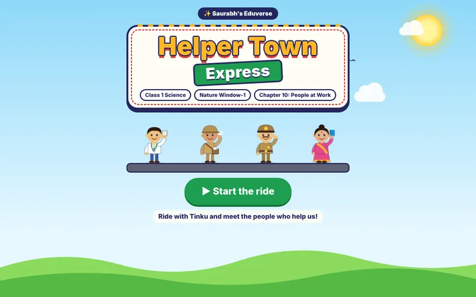</a> | **🛺 Helper Town Express** | Ch 10 · People at Work |
| <a href="games/class-1/festival-islands-3d/index.html">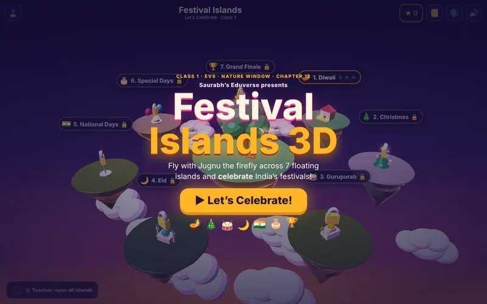</a> | **🪔 Festival Islands 3D** | Ch 12 · Let's Celebrate |

### Class 3

| | Name | Chapter |
|---|---|---|
| <a href="games/class-3/bubbly-healthy-island-3d/index.html">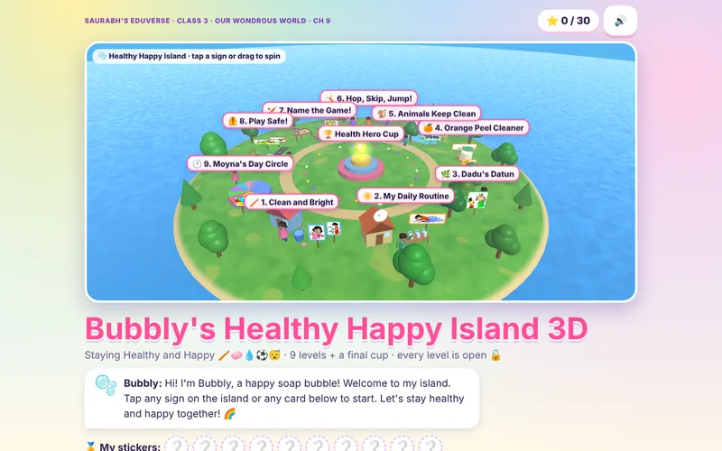</a> | **🫧 Bubbly's Healthy Happy Island 3D** | Ch 9 · Staying Healthy and Happy |
| <a href="games/class-3/birbal-crow-count/index.html">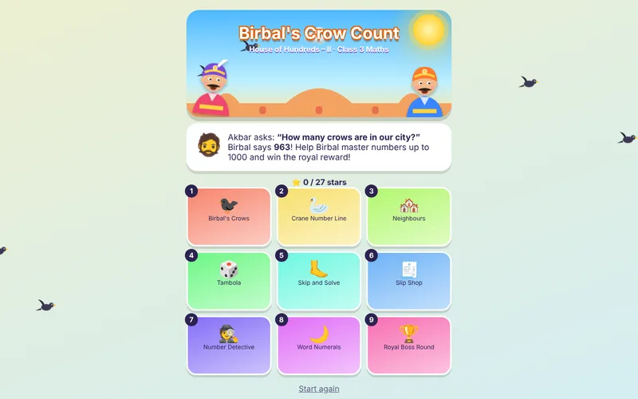</a> | **🐦 Birbal's Crow Count** | House of Hundreds |

### Class 6

| | Name | Chapter |
|---|---|---|
| <a href="games/class-6/taapu-temperature-trek/index.html"></a> | **🌡️ Taapu's Temperature Trek** | Ch 7 · Temperature and its Measurement |
| <a href="games/class-6/boondi-water-journey-3d/index.html">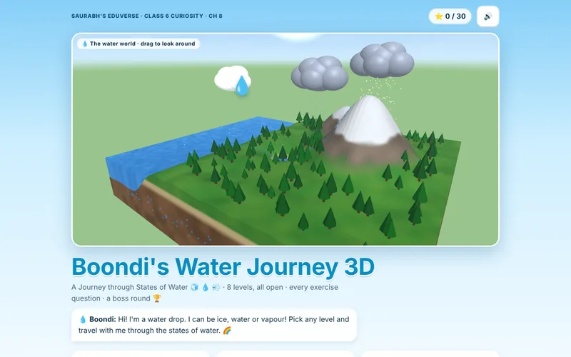</a> | **💧 Boondi's Water Journey 3D** | Ch 8 · A Journey through States of Water |
| <a href="games/class-6/bharat-ki-yatra-3d/index.html"></a> | **🚂 Bharat ki Yatra 3D** | Ch 9 · Methods of Separation in Everyday Life |

### Class 9

| | Name | Chapter |
|---|---|---|
| <a href="games/class-9/newton-games-3d/index.html">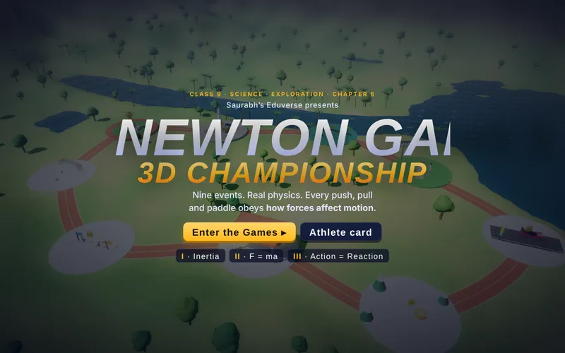</a> | **🏆 Newton Games 3D** | Ch 6 · How Forces Affect Motion |
| <a href="games/class-9/atom-lab-quest-3d/index.html"></a> | **⚛️ Atom Lab Quest 3D** | Ch 9 · Atomic Foundations of Matter |
| <a href="games/class-9/earth-system-quest-3d/index.html">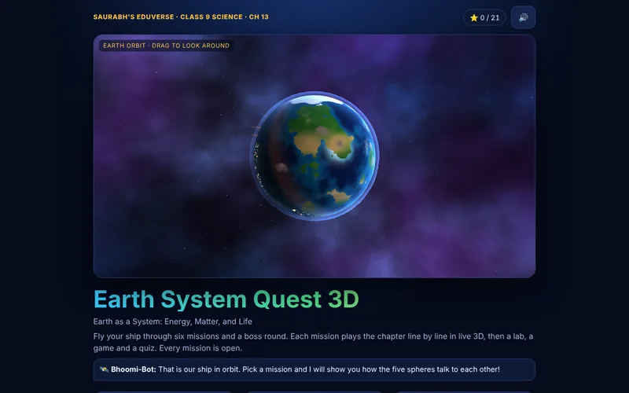</a> | **🌍 Earth System Quest 3D** | Ch 13 · Earth as a System |
| <a href="games/class-9/physics-frontier/index.html"></a> | **🏙️ Physics Frontier** | Motion, Force and Energy |

### Class 10

| | Name | Chapter |
|---|---|---|
| <a href="games/class-10/reaction-express-3d/index.html">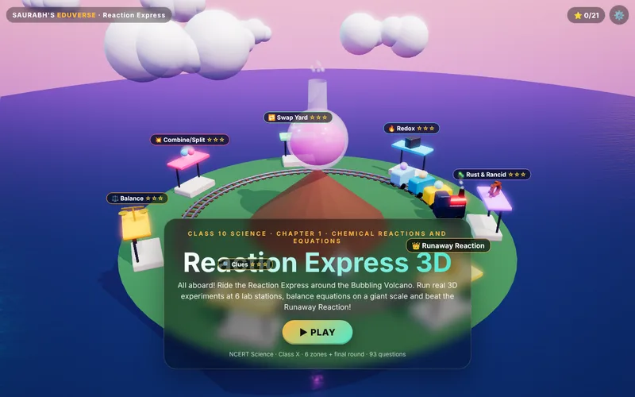</a> | **🚂 Reaction Express 3D** | Ch 1 · Chemical Reactions and Equations |
| <a href="games/class-10/ph-rainbow-isles-3d/index.html">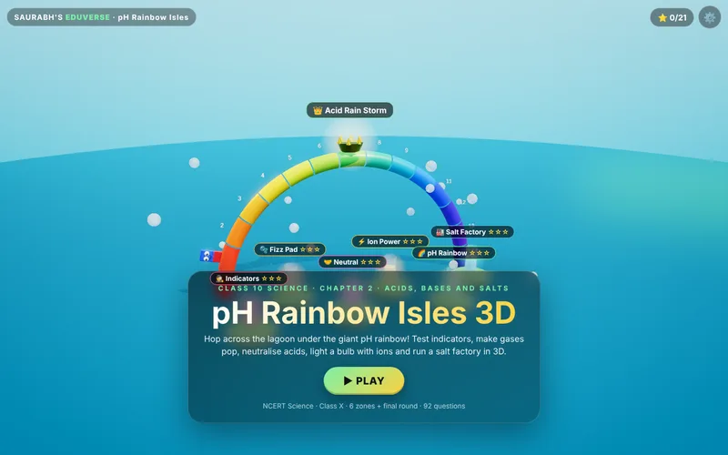</a> | **🌈 pH Rainbow Isles 3D** | Ch 2 · Acids, Bases and Salts |
| <a href="games/class-10/litmus-lab/index.html"></a> | **🧪 Litmus Lab** | Ch 2 · Acids, Bases and Salts |
| <a href="games/class-10/metal-mountain-mine-3d/index.html">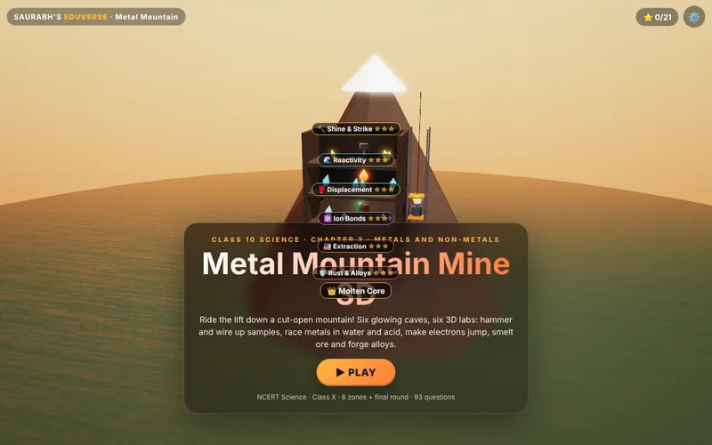</a> | **⛏️ Metal Mountain Mine 3D** | Ch 3 · Metals and Non-metals |
| <a href="games/class-10/carbon-citadel-3d/index.html"></a> | **🏰 Carbon Citadel 3D** | Ch 4 · Carbon and its Compounds |
| <a href="games/class-10/life-engine-3d/index.html">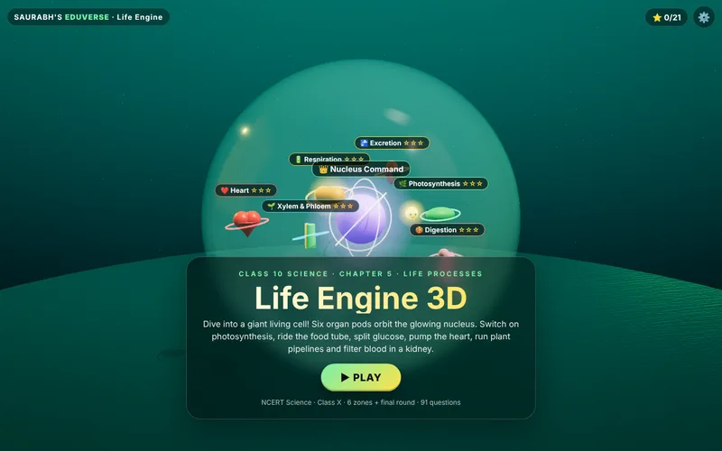</a> | **🫁 Life Engine 3D** | Ch 5 · Life Processes |
| <a href="games/class-10/synapse-voyager/index.html">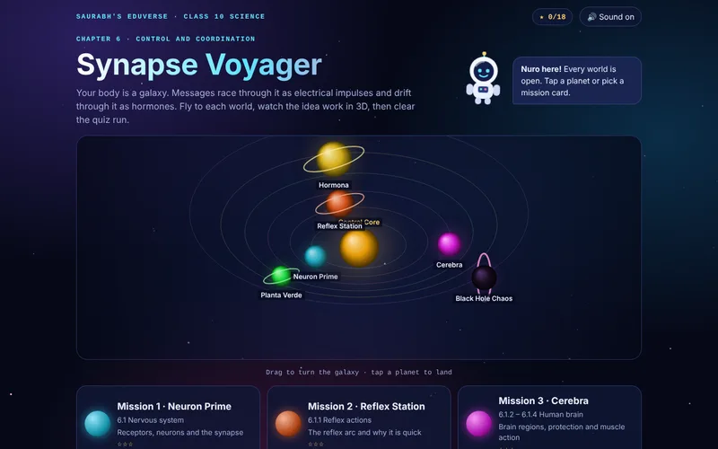</a> | **🧠 Synapse Voyager** | Ch 6 · Control and Coordination |
| <a href="games/class-10/neuroatlas-3d/index.html"></a> | **🧬 NeuroAtlas 3D** | Ch 6 · Control and Coordination |
| <a href="games/class-10/generation-spiral-3d/index.html">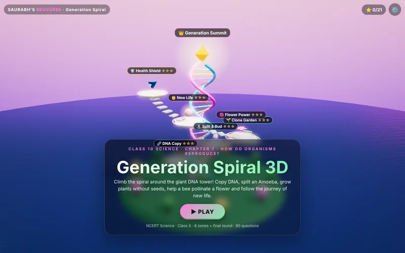</a> | **🌸 Generation Spiral 3D** | Ch 7 · How do Organisms Reproduce? |
| <a href="games/class-10/pea-code-garden-3d/index.html">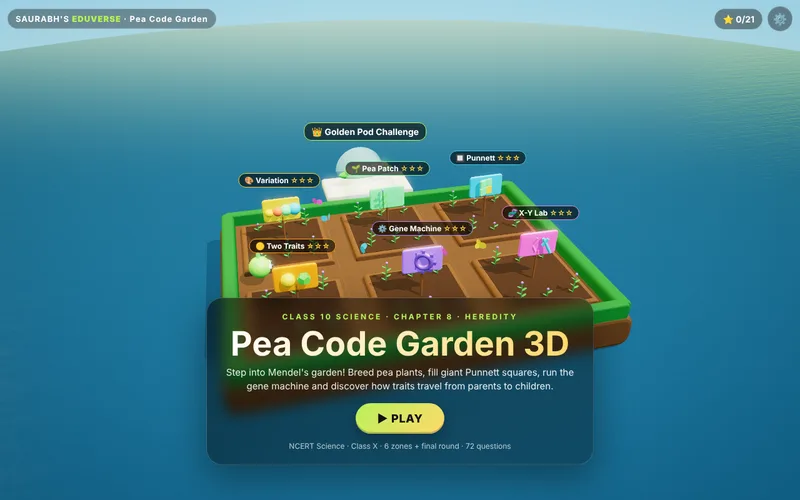</a> | **🫛 Pea Code Garden 3D** | Ch 8 · Heredity |
| <a href="games/class-10/lumina-lighthouse-3d/index.html">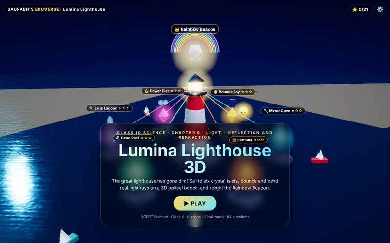</a> | **🗼 Lumina Lighthouse 3D** | Ch 9 · Light – Reflection and Refraction |
| <a href="games/class-10/iris-arch-3d/index.html">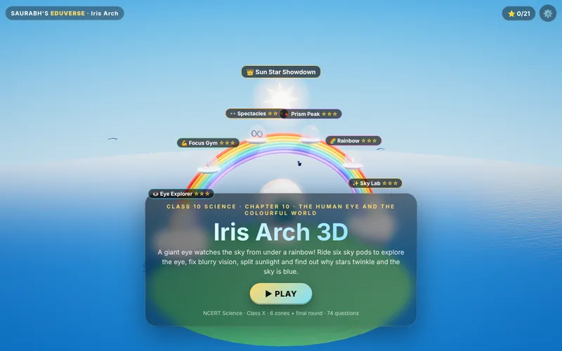</a> | **👁️ Iris Arch 3D** | Ch 10 · The Human Eye and the Colourful World |
| <a href="games/class-10/volt-city-3d/index.html"></a> | **⚡ Volt City 3D** | Ch 11 · Electricity |
| <a href="games/class-10/little-green-planet-3d/index.html">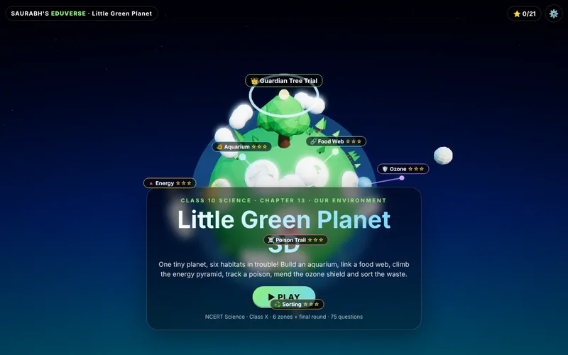</a> | **🌳 Little Green Planet 3D** | Ch 13 · Our Environment |
| <a href="games/class-10/magnet-quest-3d/index.html">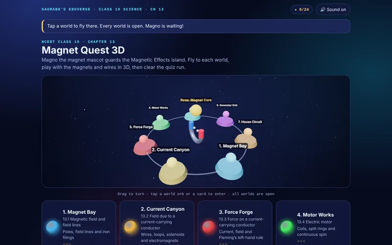</a> | **🧲 Magnet Quest 3D** | Ch 13 · Magnetic Effects of Electric Current |
| <a href="games/class-10/magnet-heredity-quiz/index.html"></a> | **📝 Magnet & Heredity MCQ Quiz** | Magnetism and Heredity |

### Fun & Skills

| | Name | About |
|---|---|---|
| <a href="games/fun/turbo-horizon-bharat/index.html">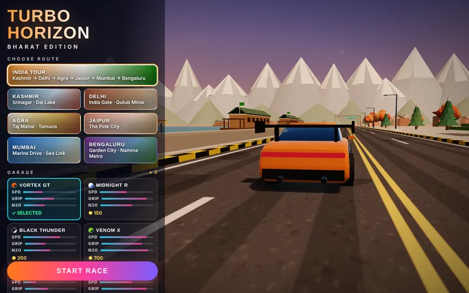</a> | **🏎️ Turbo Horizon: Bharat Edition** | Racing across India |
| <a href="games/fun/typenova-typing-trainer/index.html">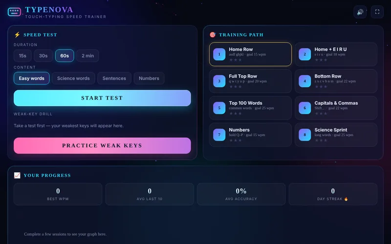</a> | **⌨️ TypeNova — Typing Trainer** | Typing speed |
| <a href="games/fun/hanami-koi-pond/index.html">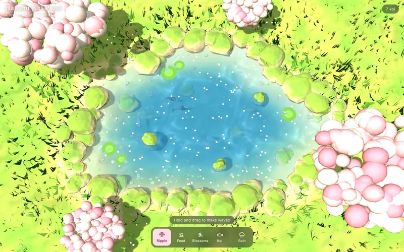</a> | **🎏 Hanami Koi Pond** | Relax at the koi pond |

### Projects & Apps

| | Name | About |
|---|---|---|
| <a href="games/apps/ai-crop-doctor-pro/index.html">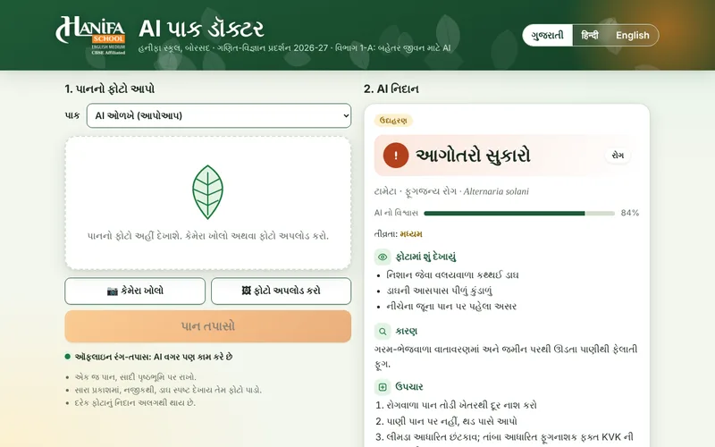</a> | **🌿 AI Crop Doctor Pro** | Find crop disease from a leaf photo |
| <a href="games/apps/ai-crop-doctor-3-languages/index.html">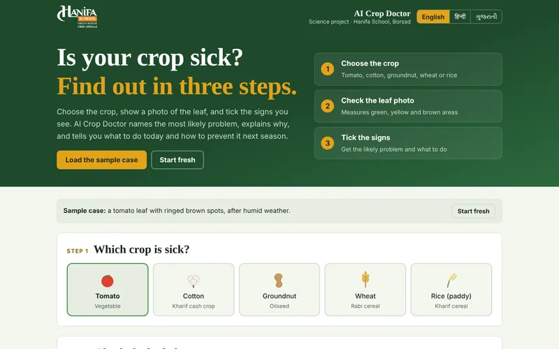</a> | **🌾 AI Crop Doctor (English · हिन्दी · ગુજરાતી)** | Find crop disease from a leaf photo |
| <a href="games/apps/ai-crop-doctor-web/index.html">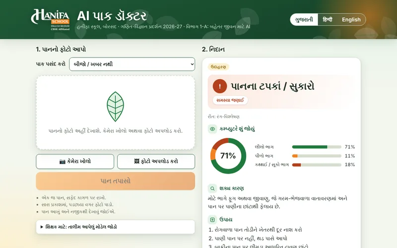</a> | **🍃 AI Crop Doctor Web** | Find crop disease from a leaf photo |
| <a href="games/apps/ai-crop-doctor-gujarati/index.html">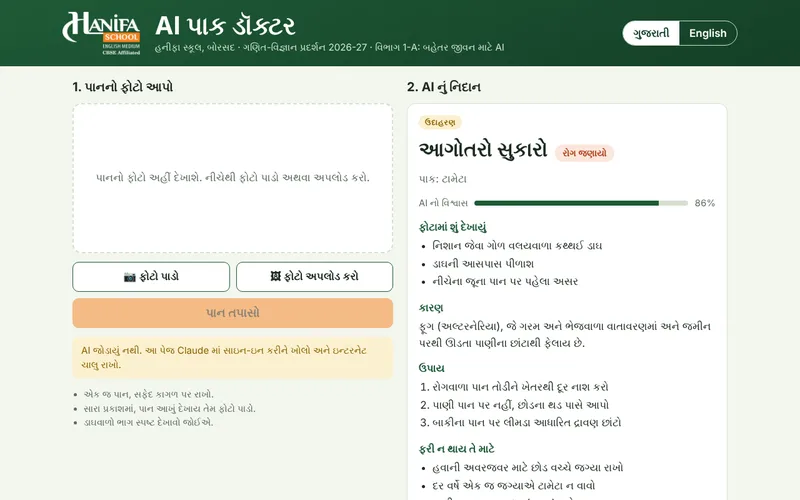</a> | **🌱 AI Crop Doctor (ગુજરાતી · English)** | Find crop disease from a leaf photo |
| <a href="games/apps/career-genius/index.html"></a> | **🎓 Career Genius** | Career guidance with a PDF report |
| <a href="games/apps/trainable-bot-studio/index.html">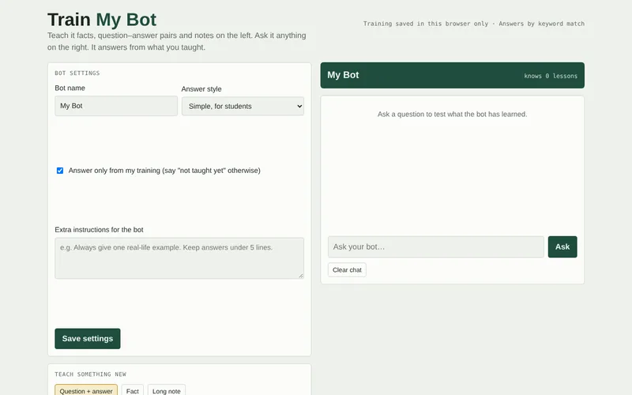</a> | **🤖 Trainable Bot Studio** | Teach your own chatbot |

## Folder layout

```
index.html            3D Science Laboratory (main lab)
bio/ chemlab/ ptable/  Biology lab, Chemistry lab, 3D Periodic Table
games/
  index.html          Games app (class tabs, search, language picker)
  catalog.js          List of games  ← add a line here for each new game
  i18n.js             App words in 23 languages
  manifest.webmanifest
  class-1/ … class-10/<game>/index.html + thumbnail.webp
  fun/                Fun & Skills games
  apps/               Projects & Apps (Crop Doctor, Career Genius, Bot Studio)
  vendor/three-r128/  three.js kept on the site so games work offline
sw.js                 Offline support for the whole site
```

## Add a new game

1. Make a folder `games/class-<N>/<game-name>/` and put the game in it as `index.html`.
2. Add a picture `thumbnail.webp` (800×500) in the same folder.
3. Add one line to `games/catalog.js`.

## Note on the apps

AI Crop Doctor, Career Genius and Trainable Bot Studio work fully on the website; their optional
AI features (AI photo check, AI answers) only switch on when opened inside Claude.

## Language support

The app menus, class names and chapter names change with the language picker.
The games themselves are written in English; on a hosted site each card shows
**🌐 Play in my language**, which opens the game through Google Translate in the chosen language
(Bodo and Kashmiri are not in Google Translate yet, so that button is hidden for them).

## Credits

three.js (MIT) · Microsoft Rocketbox avatars (MIT) · three.js example models Soldier, Michelle, Xbot (Mixamo) ·
BodyParts3D (DBCLS, CC BY 4.0) · HuBMAP Human Reference Atlas (CC BY 4.0)
