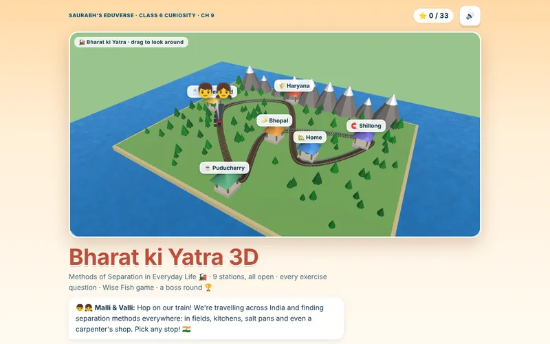
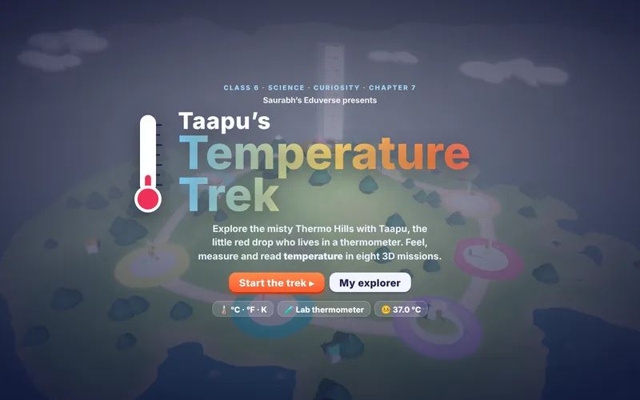
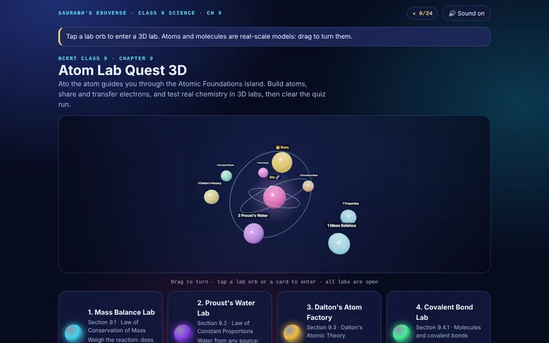
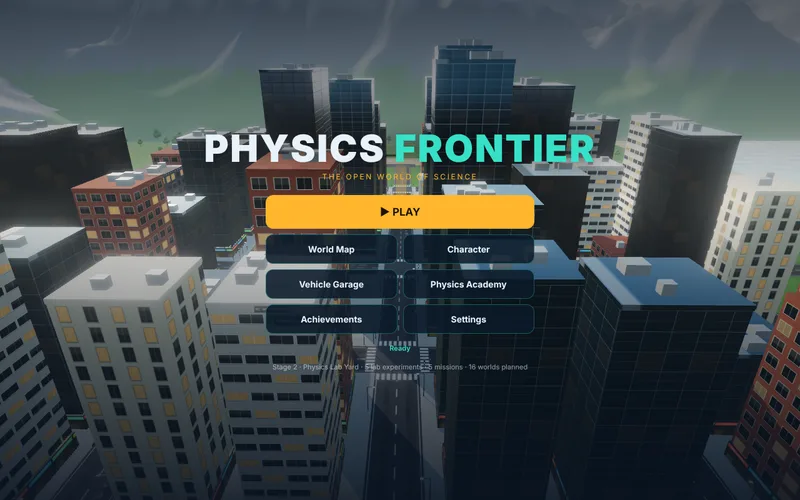
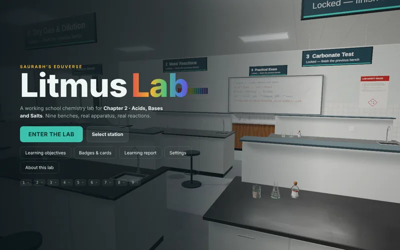
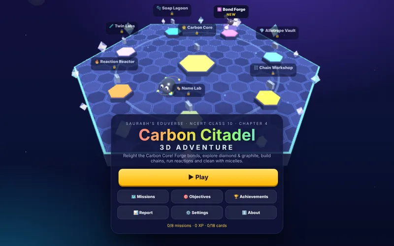
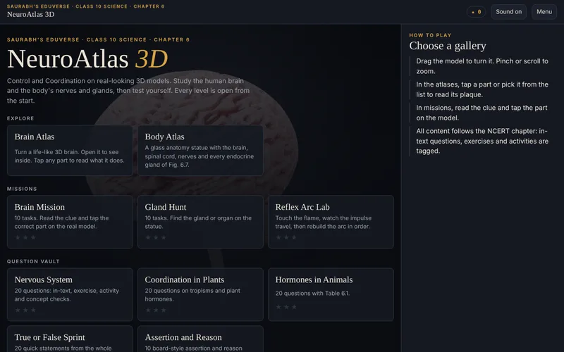
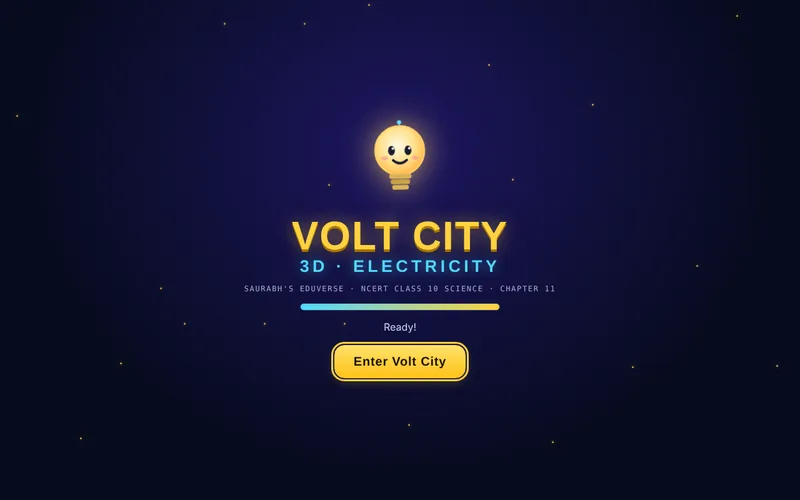
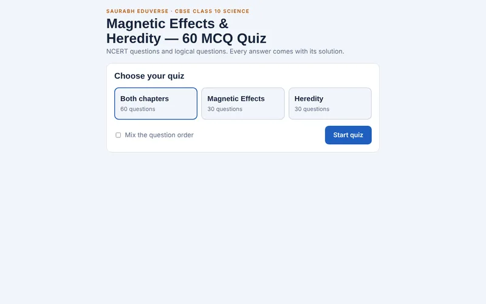

# Saurabh's EDUVERSE 🎮🔬

Free 3D science games and virtual labs for **CBSE / NCERT Class 6 to 10**, made by **Saurabh Sharma (Saurabh Sir)**, Hanifa School, Borsad.

- **Games app:** [`games/`](games/) — every game with its thumbnail, sorted by class, with search
- **Languages:** English + all **22 scheduled languages of India** (Hindi, Gujarati, Marathi, Bengali, Assamese, Odia, Punjabi, Tamil, Telugu, Kannada, Malayalam, Urdu, Sindhi, Kashmiri, Nepali, Konkani, Maithili, Dogri, Bodo, Sanskrit, Santali, Manipuri)
- **Installable app:** open the games page on an Android phone and tap **Install app** (works offline after "Save offline")
- **3D labs:** [Science Laboratory](index.html) · [Biology Lab](bio/index.html) · [Chemistry Lab](chemlab/index.html)

## Games

### Class 6

| | Game | Chapter |
|---|---|---|
| <a href="games/class-6/bharat-ki-yatra-3d/index.html"></a> | **🚂 Bharat ki Yatra 3D** | Ch 9 · Methods of Separation in Everyday Life |
| <a href="games/class-6/boondi-water-journey-3d/index.html"></a> | **💧 Boondi's Water Journey 3D** | Ch 8 · A Journey through States of Water |
| <a href="games/class-6/taapu-temperature-trek/index.html"></a> | **🌡️ Taapu's Temperature Trek** | Ch 7 · Temperature and its Measurement |

### Class 9

| | Game | Chapter |
|---|---|---|
| <a href="games/class-9/newton-games-3d/index.html"></a> | **🏆 Newton Games 3D** | Ch 6 · How Forces Affect Motion |
| <a href="games/class-9/atom-lab-quest-3d/index.html"></a> | **⚛️ Atom Lab Quest 3D** | Ch 9 · Atomic Foundations of Matter |
| <a href="games/class-9/earth-system-quest-3d/index.html"></a> | **🌍 Earth System Quest 3D** | Ch 13 · Earth as a System |
| <a href="games/class-9/physics-frontier/index.html"></a> | **🏙️ Physics Frontier** | Motion, Force and Energy |

### Class 10

| | Game | Chapter |
|---|---|---|
| <a href="games/class-10/litmus-lab/index.html"></a> | **🧪 Litmus Lab** | Ch 2 · Acids, Bases and Salts |
| <a href="games/class-10/carbon-citadel-3d/index.html"></a> | **🏰 Carbon Citadel 3D** | Ch 4 · Carbon and its Compounds |
| <a href="games/class-10/synapse-voyager/index.html"></a> | **🧠 Synapse Voyager** | Ch 6 · Control and Coordination |
| <a href="games/class-10/neuroatlas-3d/index.html"></a> | **🧬 NeuroAtlas 3D** | Ch 6 · Control and Coordination |
| <a href="games/class-10/volt-city-3d/index.html"></a> | **⚡ Volt City 3D** | Ch 11 · Electricity |
| <a href="games/class-10/magnet-quest-3d/index.html"></a> | **🧲 Magnet Quest 3D** | Ch 13 · Magnetic Effects of Electric Current |
| <a href="games/class-10/magnet-heredity-quiz/index.html"></a> | **📝 Magnet & Heredity MCQ Quiz** | Magnetism and Heredity |

## Folder layout

```
index.html            3D Science Laboratory (main lab)
bio/  chemlab/        Biology and Chemistry labs
games/
  index.html          Games app (class tabs, search, language picker)
  catalog.js          List of games  ← add a line here for each new game
  i18n.js             App words in 23 languages
  manifest.webmanifest
  class-6/<game>/index.html + thumbnail.webp
  class-9/…  class-10/…
sw.js                 Offline support for the whole site
```

## Add a new game

1. Make a folder `games/class-<N>/<game-name>/` and put the game in it as `index.html`.
2. Add a picture `thumbnail.webp` (800×500) in the same folder.
3. Add one line to `games/catalog.js`.

## Language support

The app menus, class names and chapter names change with the language picker.
The games themselves are written in English; on a hosted site each card shows
**🌐 Play in my language**, which opens the game through Google Translate in the chosen language
(Bodo and Kashmiri are not in Google Translate yet, so that button is hidden for them).

## Credits

three.js (MIT) · Microsoft Rocketbox avatars (MIT) · three.js example models Soldier, Michelle, Xbot (Mixamo) ·
BodyParts3D (DBCLS, CC BY 4.0) · HuBMAP Human Reference Atlas (CC BY 4.0)
